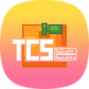

<div align="center">
  
  <h1>TaCraft Player Community</h1>
  <p><strong>为 TCS 社区打造的 Minecraft 桌面启动器。</strong></p>

  <p>
    <a href="COPYING.md">
      
    </a>
    <a href="https://www.tcscraft.com">
      
    </a>
  </p>

  <p>
    <a href="https://www.tcscraft.com">社区论坛</a> ｜
    <a href="CONTRIBUTING.md">参与贡献</a>
  </p>
</div>

---

**TaCraft Player Community** 是一款免费、开源的 Minecraft Java 版第三方启动器，基于 [Axolotl Launcher](https://github.com/Axolotl-Launcher/Axolotl) 定制，面向 TCS 社区分发。

支持在一个客户端中搜索、安装和更新来自 Modrinth 与 CurseForge 的模组、整合包、资源包和光影，并提供实例管理、多种账户认证与社区入口。

> 本项目是**非官方社区定制版**，与 Axolotl Launcher 上游团队、Mojang、Microsoft 及 Rinth, Inc. 均无关联。

## 平台支持

| 平台        | 状态                                                                       |
| ----------- | -------------------------------------------------------------------------- |
| Windows x64 | **正式支持**，提供安装包与便携版                                           |
| Linux       | **不提供发行包**。源码可自行编译，但只有交叉编译记录，没有实际跑通过的验证 |
| macOS       | **不支持**，仓库内已移除 macOS 的构建配置与发布流水线                      |

发布只做 Windows x64。Linux 和 macOS 的自编请自便，遇到问题可以提 Issue，但不保证修。

## 这一版改了什么

- **橙白配色 + 浅色主题 + 中文开箱即用**：默认浅色主题、橙色强调色、简体中文界面；老用户若仍是旧的默认设置，会在升级时自动迁移。
- **界面只保留简体中文与 English (US)**：去掉其余语言包，减少体积。
- **内置社区入口**：侧边栏新增「论坛」与「皮肤站」，分别内嵌 `tcscraft.com` 和 `tcsskins.tcscraft.com`。
- **去掉启动器自动更新，改成版本提示**：不内置更新器；改为在标题栏检查 GitHub 上的新版本，有新版时出现下载角标，可跳转下载或忽略该版本。
- **移除几个页面**：多人游戏（含陶瓦联机）、皮肤选择器、截图中心，以及主页的每日小挑战卡片。
- **精简设置面板**：移除「更新」「隐私与数据共享」「第三方账户」「AI 功能」四个设置页。
- **精简关于页**：只保留版本信息、许可证署名与新手引导重播入口。
- **去掉启动画面与美西螈形象**：不再有启动 Splash 与像素美西螈素材。
- **数据目录改为 `%APPDATA%\TCS-Community`**：与上游的 `red.ghs.axolotl` 分开，两者互不影响，旧目录里的实例不会自动迁移。

## 核心能力

- **内容生态**：集成 Modrinth 与 CurseForge，实例、整合包、模组、资源包、光影一键安装与升级。
- **个性化**：主题色调、强调色、背景图片均可自定义；皮肤可在内置的皮肤站里换。

## 技术栈

- **桌面运行时（Rust / Tauri 2）**：`packages/app-lib` 提供强类型实例管理、SQLite 状态持久化、迁移控制与多线程下载引擎；`apps/app` 是基于 Tauri 2 的原生壳，负责 IPC 与系统集成。
- **前端（Vue 3 / Vite / Tailwind CSS）**：`apps/app-frontend` 为桌面界面，`apps/website` 为官网，共享设计系统 `packages/ui`。
- **生态集成**：`packages/content-management`、`packages/api-client` 对接 Modrinth 与 CurseForge 公开 API。
- **账户**：Microsoft 正版登录、Yggdrasil 第三方验证（皮肤站等外置登录）。本版不提供离线账户登录。

## 本地构建

仓库是 pnpm workspace + turbo 的 monorepo。子模块 `third-party/blockbench` 必须先初始化，否则皮肤编辑器编不出来。

```bash
git submodule update --init --depth 1
pnpm install
```

**前端单独构建**：

```bash
cd apps/app-frontend
node node_modules/vite/bin/vite.js build
```

**桌面端（Linux 本机）**：

```bash
cd apps/app
cargo build --release
```

注意：仓库根 `.cargo/config.toml` 在 Linux 目标下写死了 `-fuse-ld=mold`，机器上没有 mold 会报 `collect2: fatal error: cannot find 'ld'`。装一个 mold，或者自己造个指向 `ld.lld` 的 shim 放 `PATH` 里。

**交叉编译 Windows x64**（需要 `cargo-xwin`、`clang`、`mingw-w64-gcc`）：

```bash
export CFLAGS="-msse4.1 -mssse3"
export CXXFLAGS="$CFLAGS"
export AXOLOTL_CUBIOMES_CC=x86_64-w64-mingw32-gcc
cargo xwin build --release --target x86_64-pc-windows-msvc \
  --manifest-path apps/app/Cargo.toml --features custom-protocol -j 1
```

产物为 `target/x86_64-pc-windows-msvc/release/theseus_gui.exe`，发布时还需要把 `apps/app/resources/`（含 `blockbench-skin`）放到 exe 同级的 `resources` 目录。

## Windows 构建

在 Windows 上直接原生编译，不需要交叉工具链。

**前置依赖**

| 依赖                   | 说明                                                      |
| ---------------------- | --------------------------------------------------------- |
| Rust                   | rustup 安装，默认 MSVC 工具链                             |
| Visual Studio 生成工具 | 勾选「使用 C++ 的桌面开发」，提供 MSVC 与 Windows SDK     |
| Node.js                | 24.11+ 或 22.21+（更老的版本会被 workspace 拒绝）         |
| pnpm                   | 10.x，`corepack enable pnpm`                              |

**打成安装包**

```bat
cd apps/app
pnpm build
```

会依次完成前端构建、Rust 编译和 NSIS 打包，安装包产物在 `target\release\bundle\nsis\`。安装模式是 `currentUser`，不需要管理员权限。

**只出可执行文件**

```bat
cargo build --release --features custom-protocol
```

产物是 `target\release\theseus_gui.exe`。运行前要把 `apps\app\resources\`（含 `blockbench-skin`）拷成 exe 同级的 `resources` 目录，否则皮肤编辑器的资源会缺失。

首次编译时 `build.rs` 会自己 `npm ci` 并构建皮肤编辑器资源，需要联网和 `PATH` 里的 node。临时跳过可以设 `AXOLOTL_SKIP_BLOCKBENCH_BUILD=1`，但跳过之后打包会因为缺少 `resources/blockbench-skin` 直接失败，只适合改 Rust 逻辑时的快速迭代。

## 社区

- 论坛：<https://www.tcscraft.com>
- 问题反馈：本仓库的 Issues

## 许可证

本项目沿用上游的 **GPL-3.0** 许可证，详见 [COPYING.md](COPYING.md)。

原项目：[Axolotl Launcher](https://github.com/Axolotl-Launcher/Axolotl)（GPL-3.0），上游又基于 [Modrinth App](https://github.com/modrinth/code)。感谢上游所有贡献者。
